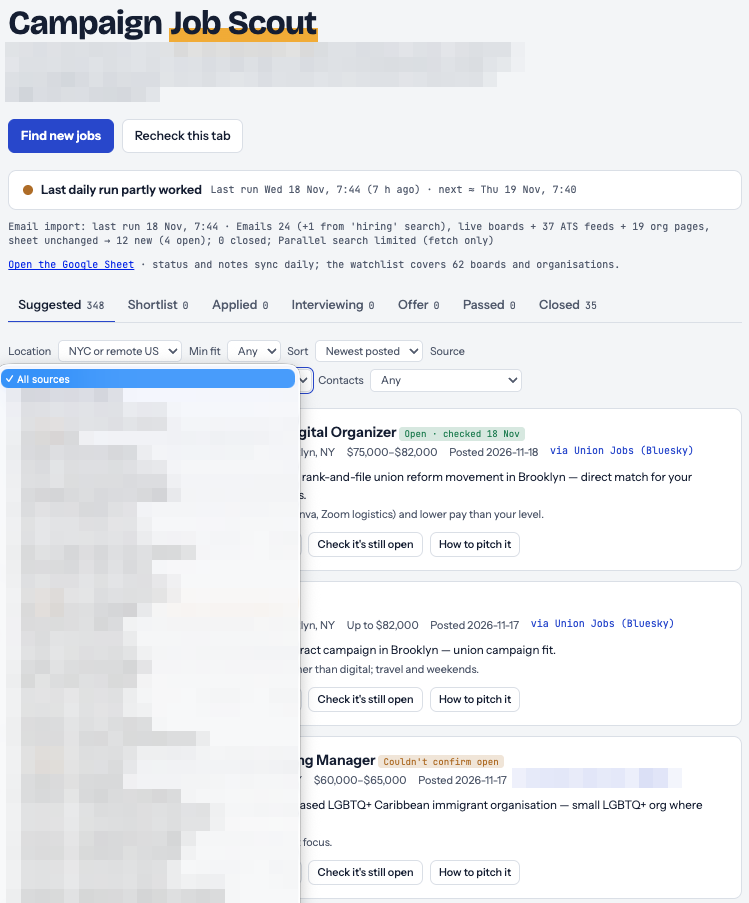
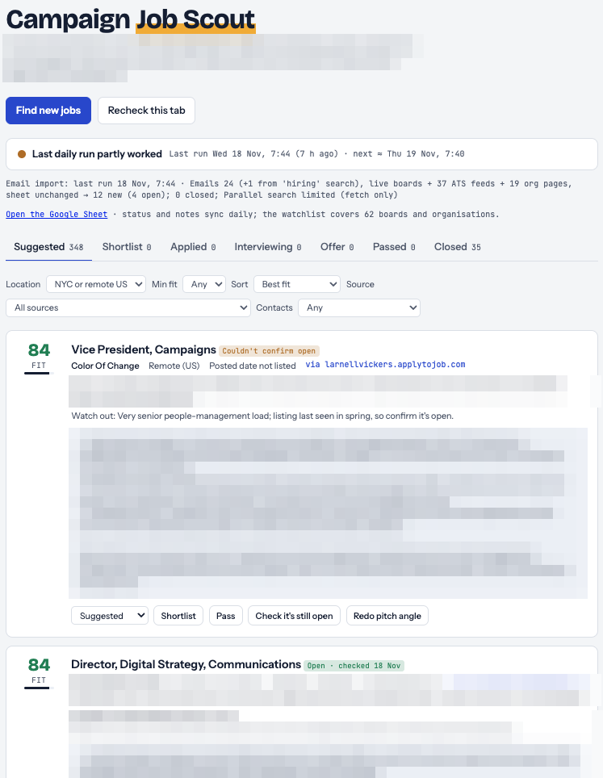
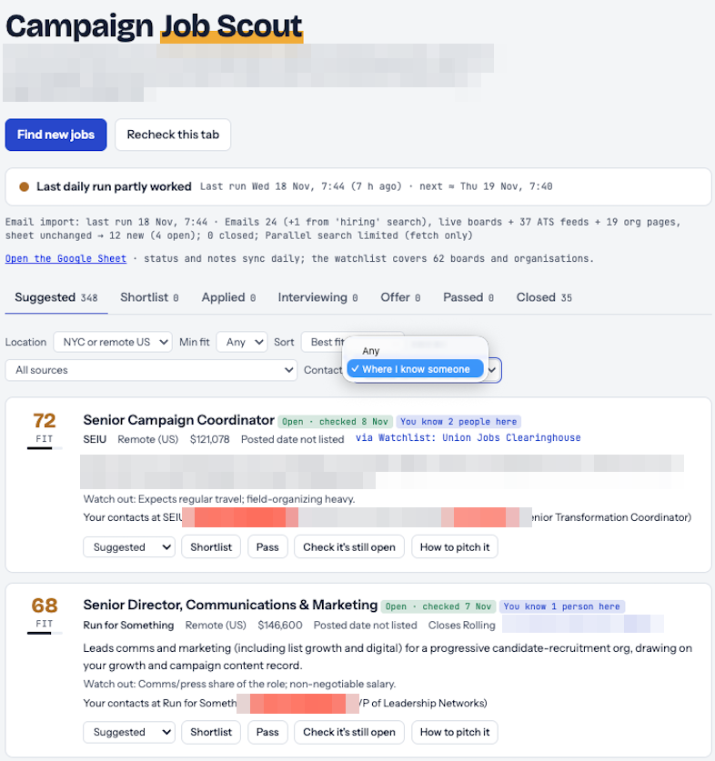
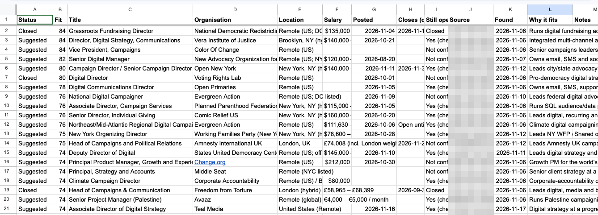

# Movement Match

**Matching people in progressive movements to the roles they're best suited for.**

Movement Match is a free, open-source Claude skill. You give it your past resumes and cover letters. Every morning it checks job lists, listservs and the careers pages of hundreds of organizations you choose, ranks every role by how well it fits you, and tells you what matches and what doesn't. You set it up in a 20-minute conversation with Claude.

**[Download the skill](https://github.com/kewuh/progressive-job-matcher/raw/main/dist/movement-match-skill.zip)** · [How it works](#how-it-works) · [Install](#install) · [Safety](#built-to-be-safe)



## The problem

Every election cycle and funding shift sends thousands of organizers, campaigners and digital staff looking for their next role. Many of them leave the movement, not for lack of jobs, but because the right job is so hard to find.

Progressive hiring is scattered across union and movement listservs, weekly job digests, Bluesky posts, and the careers pages of hundreds of small organizations. The groups most likely to hire a given organizer (digital-first nonprofits, unions and progressive agencies) often never post on the big job boards. So people spend hours a week trawling, miss deadlines, and end up applying to the famous institutions where competition is fiercest and their odds are worst.

## How it works

You start by giving it your past resumes and cover letters. From them it builds a detailed picture of your experience, skills, achievements and the kinds of roles you've gone for, and it learns which applications got interviews and which didn't. Then, every morning, it:

- **Watches the organizations you'd most like to work for.** Point it at hundreds of organizations' own careers pages (the movement groups, unions and agencies you'd love to join) and it checks them directly, so you see openings even when they're never posted anywhere else. Add an organization just by naming it, and it finds the careers page itself. For organizations on Greenhouse, Lever, Ashby, Rippling or UltiPro, it reads the complete live list of openings every day, catching new roles the day they appear and noticing when one closes.
- **Covers everything else.** It reads your job-alert emails and movement listservs (read-only) and follows job-sharing Bluesky accounts.
- **Ranks every role by fit.** Each job gets a score from 0 to 100 against your actual experience, so the best matches rise to the top and weak ones sink. The kinds of organizations where your track record shows you have real odds rank higher.
- **Tells you why.** For each role it explains what matches and what doesn't, for example "a direct fit for your union campaign and corporate accountability work" and "watch out: expects regular travel; field-organizing heavy." You can decide in seconds whether to apply.
- **Helps you pitch.** On request, it suggests which achievements to lead with in your application and how to address the main gap.
- **Opens doors.** Upload your LinkedIn connections export and it flags jobs at organizations where you already know someone, so you can ask for a warm introduction instead of applying cold.
- **Keeps it current.** It confirms each posting is still open, finds the employer's own application link, closes jobs once deadlines pass, and tracks everything in a private dashboard and a Google Sheet, from Suggested to Applied to Interviewing.

### Fit scores and pitch angles

Every job comes with a fit score, the reasons behind it, and on request a pitch angle tailored to your experience.



### Warm introductions

The Contacts filter shows only jobs at organizations where you know someone, with each contact's role and a link to their LinkedIn profile.



### Tracker sheet

Every job also goes into a Google Sheet. Status, fit and notes you edit in the sheet sync back to the dashboard each day.



*Screenshots are from the author's own setup, which used the working name "Job Scout". Personal details and contacts' names are blurred.*

## Results so far

I built Movement Match for my own search, starting from more than 40 past applications. Each morning it now checks more than 60 job lists and sites, and the careers pages of nearly 400 movement organizations, 37 of them through their live job boards. In under two weeks it surfaced and ranked more than 380 roles, many from small organizations and listservs I'd never have found on my own, and flagged 20 open jobs at organizations where I already know someone.

## Built to be safe

Movement Match is designed to be left running every day without supervision:

- **Read-only email and Drive.** It never sends, replies, drafts, labels or deletes anything.
- **One place to write.** It writes only to your own Movement Match dashboard and your one tracker sheet.
- **Never acts for you.** It never logs in, creates accounts, applies, messages or posts on your behalf, and never tries to get around a site's bot checks.
- **Ignores instructions in content.** It treats every email and web page as information, not instructions.
- **Respects privacy.** It skips personal emails that aren't about jobs and doesn't store phone numbers or addresses. LinkedIn connections stay in your private database; their email addresses are never kept, and nothing is ever sent to them.

## What you need

- A paid Claude plan (Pro or higher) for the automatic daily run
- **Gmail** and **Google Sheets** connectors in Claude (Settings → Connectors)
- A **web search** connector (for checking job pages and the dashboard's "Find new jobs" button)
- Somewhere to run it daily: the Claude desktop app's scheduled tasks, or Claude Code on the web
- Optional: Claude in Chrome, for a daily LinkedIn scan on your own computer

## Install

**Claude app or claude.ai (skill):** download [`movement-match-skill.zip`](https://github.com/kewuh/progressive-job-matcher/raw/main/dist/movement-match-skill.zip), then go to Settings → Capabilities → Skills → Upload skill.

**Claude Code (plugin):**

```bash
claude plugin marketplace add kewuh/progressive-job-matcher
```

```bash
claude plugin install movement-match@movement-match
```

Or copy `skills/movement-match` into `~/.claude/skills/`.

## Set up

Start a chat and say **"Set up Movement Match"**. Claude will:

1. Build your profile from your past resumes and cover letters, plus what you're looking for: roles, levels, places, dealbreakers, and where your odds are best.
2. Publish your private dashboard.
3. Ask you to make a blank Google Sheet (it only ever writes to that one sheet) and set up the tracker tab.
4. Help you choose sources: email alerts and listservs, the organizations you'd most like to work for, job sites to watch, Bluesky accounts.
5. Schedule the daily run.
6. Optionally, flag jobs where you know someone: upload your LinkedIn data export (Settings & Privacy → Data privacy → Download your data → Connections).
7. Optionally, set up the LinkedIn scan on your computer.

After that, ask **"run my job scan"** any time, or let the schedule do it.

## What's in the repo

| Path | What it is |
|---|---|
| `skills/movement-match/SKILL.md` | The skill: what Movement Match is, ground rules, data model |
| `skills/movement-match/references/` | Setup guide, the daily-run prompt, scoring rules, how to find sources, LinkedIn contacts and the LinkedIn scan |
| `skills/movement-match/assets/dashboard.html` | The dashboard artifact |
| `skills/movement-match/scripts/live_boards.py` | Reads Greenhouse, Lever, Ashby, Rippling and UltiPro boards and Bluesky feeds |
| `skills/movement-match/scripts/contacts.py` | Groups your LinkedIn connections by employer and matches them to your jobs |
| `skills/movement-match/scripts/job_id.py` | The job-id hash shared with the dashboard |
| `skills/movement-match/templates/` | Example profile and config |
| `.claude-plugin/` | Claude Code plugin and marketplace manifests |
| `dist/movement-match-skill.zip` | The skill, zipped for upload to Claude |

Run the board scanner yourself with:

```bash
python3 skills/movement-match/scripts/live_boards.py --config my-config.json --out live.json
```

## License

Code is MIT-licensed. Documentation (prompts, guides) may be shared under CC BY 4.0.
